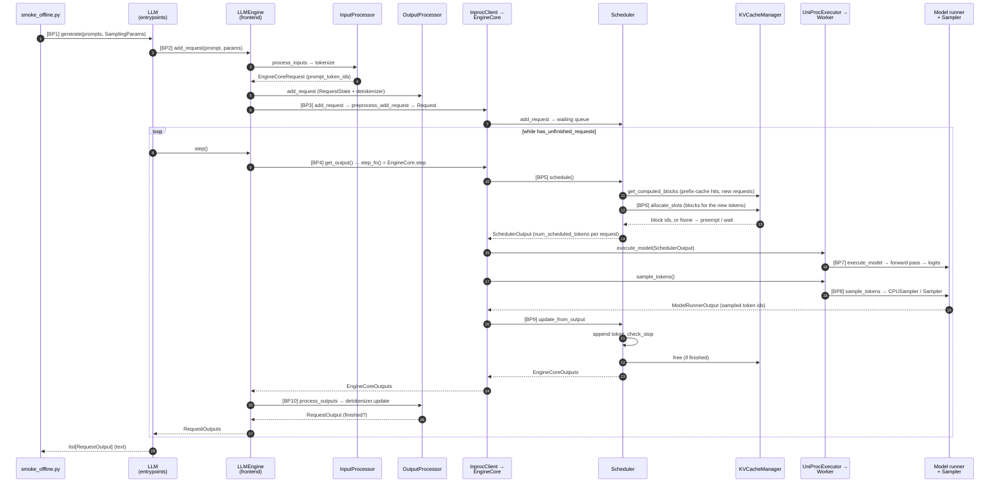
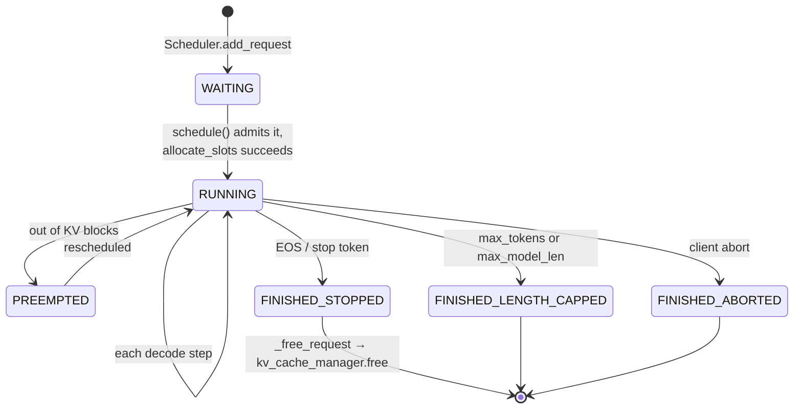
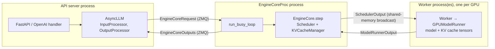

# vLLM v1 Request Lifecycle

The path of one request through vLLM v1, from `LLM.generate` to the returned text, with the functions to break on. Traced on the Mac CPU build at vLLM `cef9a453b2` (2026-11-08) using `smoke_offline.py` with `VLLM_ENABLE_V1_MULTIPROCESSING=0`. The breakpoint list and VS Code setup are in [README.md](README.md) ("Debugging the request lifecycle in VS Code").

Line numbers are for `cef9a453b2` and drift with every upstream commit. In VS Code, jump by symbol (`Cmd+T`) rather than by line.

## Table of Contents
- [[#The Big Picture]]
- [[#Sequence Diagram]]
- [[#Request States]]
- [[#Stage by Stage]]
- [[#Prefill vs Decode Steps]]
- [[#Offline vs Online Serving]]
- [[#Breakpoint Exercise]]
- [[#Questions to Answer While Stepping]]

## The Big Picture
vLLM v1 splits a request's life across three layers:

| Layer | Runs where | Owns | Key classes |
|---|---|---|---|
| **Frontend** | The user's process | Tokenization, detokenization, the per-request output queue | `LLM` / `LLMEngine` (offline), `AsyncLLM` (API server), `InputProcessor`, `OutputProcessor` |
| **EngineCore** | Same process (`InprocClient`, our debug setup) or a separate process (`EngineCoreProc` over ZMQ, the default) | The step loop, the scheduler, the KV block pool | `EngineCore`, `Scheduler`, `KVCacheManager` |
| **Workers** | In-process (`UniProcExecutor`) or one process per GPU (`MultiprocExecutor`) | The model weights, the KV cache tensors, the forward pass and sampling | `Worker` / `CPUWorker`, `GPUModelRunner` / `StandaloneCPUModelRunner`, `Sampler` / `CPUSampler` |

The core loop is three calls in `EngineCore.step`: **schedule → execute → update**. Every iteration decides which requests run and how many tokens each gets, runs one forward pass over that batch, then folds the sampled tokens back into each request.

## Sequence Diagram
One request, offline API, in-process engine (our debug setup). The circled numbers give the order of every call and return (28 in all). Arrows tagged **[BP n]** are where breakpoint n of the README's 10-row table stops; the rest are calls you pass through with `F11` (step into). The `#` column in [[#Stage by Stage]] uses the BP numbers. A standalone image is in [request_lifecycle_sequence.png](request_lifecycle_sequence.png).



## Request States
`RequestStatus` in `vllm/v1/request.py:425`. Only the common path is shown; the `WAITING_FOR_*` states cover structured-output grammars, remote KV transfer and streaming input. Preemption: when `allocate_slots` can't find blocks, the scheduler preempts the lowest-priority running request, frees its blocks, and later reschedules it, recomputing its KV cache. Standalone image: [request_states.png](request_states.png).



All 12 states. The enum order matters: every state after `PREEMPTED` counts as finished, and `RequestStatus.is_finished()` is just that comparison.

| Group | State | When it is entered |
|---|---|---|
| **Waiting** | `WAITING` | `Scheduler.add_request` has queued it in `scheduler.waiting` |
| | `WAITING_FOR_STRUCTURED_OUTPUT_GRAMMAR` | Structured output (a JSON schema, for example) whose grammar is still compiling asynchronously; it can't be scheduled until the grammar is ready |
| | `WAITING_FOR_REMOTE_KVS` | Prefill/decode disaggregation or a KV connector: waiting for KV to arrive from a remote instance |
| | `WAITING_FOR_STREAMING_REQ` | A streaming-input session is paused, waiting for the next chunk of input (`scheduler.py:2874`) |
| **Running** | `RUNNING` | `schedule()` picked it and KV blocks were allocated; it is in the `scheduler.running` list |
| **Preempted** | `PREEMPTED` | `_preempt_request` (`scheduler.py:1853`) freed its blocks and put it back at the front of the waiting queue |
| **Finished** | `FINISHED_STOPPED` | EOS, a stop token or a stop string; `finish_reason="stop"` |
| | `FINISHED_LENGTH_CAPPED` | Hit `max_tokens` or `max_model_len`; `finish_reason="length"` |
| | `FINISHED_ABORTED` | Cancelled: the client disconnected, or the frontend aborted it after matching a stop string; `finish_reason="abort"` |
| | `FINISHED_IGNORED` | The prompt alone exceeds the length limit, so it is rejected outright; `finish_reason="length"` |
| | `FINISHED_ERROR` | An error, such as a failed KV load (`scheduler.py:2497`); `finish_reason="error"` |
| | `FINISHED_REPETITION` | Repetition detection fired (`vllm/v1/core/sched/utils.py:136`); `finish_reason="repetition"` |

The smoke test only goes through **`WAITING` → `RUNNING` → `FINISHED_LENGTH_CAPPED`**: with `max_tokens=48`, both requests run until they reach 48 output tokens.

## Stage by Stage
`#` is the breakpoint number in the README table and the **[BP n]** tag in the diagram. In each row, the **bold** function is the one the breakpoint sits on; the others are the calls around it.

| #   | Stage                  | Where (`cef9a453b2`)                                                                                                                                                                                                                                                     | What happens                                                                                                                                                                                                                                                                                 |
| --- | ---------------------- | ------------------------------------------------------------------------------------------------------------------------------------------------------------------------------------------------------------------------------------------------------------------------ | -------------------------------------------------------------------------------------------------------------------------------------------------------------------------------------------------------------------------------------------------------------------------------------------- |
| 1   | Entry                  | `vllm/entrypoints/llm.py:424` **`LLM.generate`** → `vllm/entrypoints/common/offline.py:340` `_run_completion`                                                                                                                                                            | Normalizes prompts and `SamplingParams`, adds every request, then runs the engine loop                                                                                                                                                                                                       |
| 2   | Tokenize               | `vllm/v1/engine/llm_engine.py:229` **`LLMEngine.add_request`** → `input_processor.process_inputs` (line 271)                                                                                                                                                             | Receives the already-rendered prompt (`prompt_token_ids` were produced earlier, in `_preprocess_cmpl_one` → `renderers/base.py:677`; see question 1), validates it, wraps it in an `EngineCoreRequest`. Registers a `RequestState` with the `OutputProcessor` (line 297), which holds the incremental detokenizer                                                                                                                    |
| 3   | Enqueue                | `vllm/v1/engine/core_client.py:434` `InprocClient.add_request` → `vllm/v1/engine/core.py:1258` `preprocess_add_request` → `core.py:564` **`EngineCore.add_request`** → `vllm/v1/core/sched/scheduler.py:3065` `Scheduler.add_request`                                    | `EngineCoreRequest` → `Request` (computes block hashes for prefix caching). Status `WAITING`, appended to `scheduler.waiting`                                                                                                                                                                |
| 4   | Engine loop            | `offline.py:589` `_run_engine`: `while has_unfinished_requests(): llm_engine.step()` → `llm_engine.py:319` `step` → `core_client.py:424` `get_output` → `core.py:713` **`EngineCore.step`**                                                                              | One iteration per call. `step_fn` is `step`, or `step_with_batch_queue` when pipelining is on                                                                                                                                                                                                |
| 5   | Schedule               | `scheduler.py:716` **`Scheduler.schedule`**                                                                                                                                                                                                                              | Starts from `token_budget = max_num_scheduled_tokens`. First loops over `self.running` (decodes and unfinished chunked prefills), then admits from `self.waiting` while budget and KV blocks last. Returns a `SchedulerOutput` (`scheduled_new_reqs`, cached reqs, `num_scheduled_tokens`)   |
| 6   | KV blocks              | `vllm/v1/core/kv_cache_manager.py:288` `get_computed_blocks` (prefix-cache hits, new requests only), `:401` **`allocate_slots`**                                                                                                                                         | PagedAttention's bookkeeping: hands out fixed-size block ids from the free pool. `None` means no room, so the scheduler preempts the lowest-priority running request (`_preempt_request`, `scheduler.py:1853`) or leaves the new one waiting                                                 |
| 7   | Forward                | `vllm/v1/executor/uniproc_executor.py:119` `execute_model` → `collective_rpc` → `Worker.execute_model` (`vllm/v1/worker/gpu_worker.py:1442`; `CPUWorker` inherits it) → `vllm/v1/worker/cpu/standalone_model_runner.py:996` **`StandaloneCPUModelRunner.execute_model`** | Applies the `SchedulerOutput` to the persistent input batch, builds flattened `input_ids` / positions / block tables, runs the model, keeps the logits                                                                                                                                       |
| 8   | Sample                 | `model_executor.sample_tokens` inside `EngineCore.step` → `uniproc_executor.py:134` → `standalone_model_runner.py:1173` `sample_tokens` → `vllm/v1/worker/cpu/sampler.py:543` **`CPUSampler.__call__`**                                                                  | Logits → next token id per request (greedy with `temperature=0`). Returns a `ModelRunnerOutput`                                                                                                                                                                                              |
| 9   | Update                 | `scheduler.py:2301` **`Scheduler.update_from_output`** → `:2879` `_update_request_with_output` → `vllm/v1/core/sched/utils.py:98` `check_stop`                                                                                                                           | Appends the token, advances `num_computed_tokens`, caches full blocks for prefix reuse, checks EOS / `max_tokens` / `max_model_len`. Finished requests go through `_free_request` → `_free_blocks` → `kv_cache_manager.free` (`scheduler.py:3229`). Emits one `EngineCoreOutput` per request |
| 10  | Detokenize             | `vllm/v1/engine/output_processor.py:731` **`OutputProcessor.process_outputs`** → `detokenizer.update` (line 828)                                                                                                                                                         | New token ids → incremental text, stop strings, logprobs. Builds a `RequestOutput`; `finished=True` once the engine reported a finish reason                                                                                                                                                 |
| —   | Return (no breakpoint) | `offline.py` `_run_engine`                                                                                                                                                                                                                                               | Collects finished outputs, sorts them back into prompt order, returns them from `LLM.generate`                                                                                                                                                                                               |

On GPU (Kaggle), rows 7–8 are `GPUModelRunner.execute_model` / `sample_tokens` in `vllm/v1/worker/gpu_model_runner.py` and `Sampler.forward` in `vllm/v1/sample/sampler.py`. Everything else is the same code.

## Prefill vs Decode Steps
vLLM v1 has no separate "prefill phase" or "decode phase". Each step schedules a number of tokens per request, and the same forward pass handles both:

| | First step for a request (prefill) | Later steps (decode) |
|---|---|---|
| `num_scheduled_tokens[req]` | Prompt length minus prefix-cache hits, capped by the token budget (longer prompts are chunked over several steps) | 1 (more with speculative decoding) |
| `allocate_slots` | Blocks for the whole scheduled chunk | Usually nothing new; one block each time the sequence crosses a `block_size` boundary |
| Output | The first generated token (TTFT ends here) | One more token (one ITL interval) |

A single batch can mix both kinds of request. This is the mixing that explains our Week 1 benchmark gap: vLLM puts prefill chunks into decode steps by default, while SGLang runs prefill first ([LOG.md](../LOG.md), Triton experiment).

## Offline vs Online Serving
Our debug run uses the offline `LLM` class with the engine in-process. `vllm serve` uses the same EngineCore, wired differently:



- **Why separate processes.** Tokenization, detokenization and HTTP handling stay off the step loop's critical path, so the GPU isn't idle while Python does frontend work.
- **Why we turn it off for debugging.** With `VLLM_ENABLE_V1_MULTIPROCESSING=0`, `LLMEngine` uses `InprocClient`, and `get_output()` calls `EngineCore.step` directly. Breakpoints in the scheduler then hit in the debugged process.

## Breakpoint Exercise
Run **vLLM smoke (CPU, in-process)** in VS Code with breakpoints on rows 2, 5, 6, 9 and 10 at least. `smoke_offline.py` sends 2 prompts with `temperature=0.0, max_tokens=48`. Fill in what you see. This turns the diagram from "read" into "observed".

| Observation | Where to read it | Value |
|---|---|---|
| Prompt token counts | Row 2: `len(request.prompt_token_ids)` | |
| `max_num_scheduled_tokens` (token budget) | Row 5: `self.max_num_scheduled_tokens` | |
| `block_size` | Row 5: `self.block_size` on the `Scheduler` (or `self.cache_config.block_size`) | |
| Free blocks before the first prefill | Row 6: `self.block_pool.get_num_free_blocks()` on the `KVCacheManager` | |
| Step 1: `num_scheduled_tokens` per request | Row 5, the returned `SchedulerOutput` | |
| Step 1: block ids per request | Row 6, the return value of `allocate_slots` | |
| Step 2: `num_scheduled_tokens` per request | Row 5 | |
| First step where `allocate_slots` returns a new block | Row 6 (condition the breakpoint on a non-empty result) | |
| Finish reason and step number | Row 9: `request.status` after `check_stop` | |
| Free blocks after both finish | Row 9, after `kv_cache_manager.free` | |

Tips:
- Skip the startup noise (model load, KV profiling, warm-up call the runner before any real request). Add the condition `len(self.waiting) > 0 or len(self.running) > 0` on row 5.
- **Call Stack** shows rows 4 → 5 → 6 nested inside one `EngineCore.step`.
- To see PagedAttention's indirection in the runner, inspect the block table the runner builds from the `SchedulerOutput`: logical token positions map to block ids that need not be contiguous.

## Questions to Answer While Stepping
1. Where exactly does a prompt stop being a string and become token ids, and where do token ids become text again? (Both in the frontend, never in EngineCore. Tokenization actually runs before row 2.)

   **Answer.** Both conversions happen in the frontend process. EngineCore only ever sees token ids.

   *String → token ids.* In offline mode the prompt is tokenized while it is rendered, before `LLMEngine.add_request` (BP2) runs. This is the "Rendering prompts" progress bar.
   ```
   LLM.generate (BP1)
   └─ offline._run_completion → _render_and_add_requests
      └─ _preprocess_cmpl_one                vllm/entrypoints/common/offline.py:147
         └─ renderer.render_cmpl             offline.py:141
            └─ _tokenize_singleton_prompt    vllm/renderers/base.py:711
               └─ _tokenize_prompt           base.py:667
                  └─ tokenizer(prompt["prompt"], ...)   base.py:677   → prompt_token_ids
   ```
   - By the time BP2 is hit, both prompts have already been rendered. `InputProcessor.process_inputs` receives an `engine_input` that already holds `prompt_token_ids`. It only validates the input and wraps it in an `EngineCoreRequest`.
   - `input_processor.py:396` still has a deprecated path that calls `render_cmpl` on a raw string. `LLM.generate` does not take it.
   - To watch the conversion, set a breakpoint at `base.py:677` and inspect `encoding.input_ids`.

   *Token ids → text.* Detokenization is incremental and runs once per step for every request with new tokens.
   ```
   LLMEngine.step → OutputProcessor.process_outputs (BP10)   vllm/v1/engine/output_processor.py:731
   └─ req_state.detokenizer.update(new_token_ids, ...)        output_processor.py:828
      └─ IncrementalDetokenizer.update                         vllm/v1/engine/detokenizer.py:98
         └─ decode_next(token_id), once per new token          detokenizer.py:224
            └─ FastIncrementalDetokenizer: tokenizers.DecodeStream.step
   ```
   - Each step decodes only the new tokens and appends them to `output_text`. The full sequence is never decoded again from scratch.
   - `DecodeStream` is primed with `prompt_token_ids` (`detokenizer.py:197`). That way the first output token's leading space and merged characters come out right.
   - `update()` also matches stop strings. Stop strings are therefore a frontend check. EngineCore's `check_stop` only handles EOS, stop token ids, `max_tokens` and `max_model_len`.

2. Why does EngineCore never see text? What does that buy the multiprocess design?

   **Answer.** EngineCore schedules tokens and runs them on the GPU, and none of that needs text. The frontend owns every string, which buys speed and scale.

   *Why text is unnecessary.* `EngineCoreRequest` (`vllm/v1/engine/__init__.py:164`) carries `prompt_token_ids`, `sampling_params` and a `request_id`. It has no prompt string. The reply, `EngineCoreOutput` (`:264`), carries only `new_token_ids`. Every stage between them counts tokens. The scheduler spends a token budget, the KV cache manager hashes and allocates per block of tokens, the runner does the forward pass and the sampler emits token ids.

   *What the split buys.*

   | Benefit | Why |
   |---|---|
   | The GPU never waits on string work | Tokenization, detokenization, chat templates, HTTP and JSON are CPU-bound Python. In a separate process they don't compete with the step loop for the GIL, so EngineCore keeps scheduling back to back |
   | Small, cheap messages between processes | The processes exchange `msgspec.Struct`s over ZMQ with msgpack (`vllm/v1/serial_utils.py:135` `MsgpackEncoder`). Each step returns a few new token ids per request, not the growing text |
   | The frontend scales out | Text processing is stateless, so several API server processes (`--api-server-count`, `vllm/entrypoints/cli/serve.py`) can feed the same EngineCore, or several data-parallel EngineCores, without changing the engine |
   | The engine doesn't depend on the tokenizer | Swapping the tokenizer (Hugging Face, Mistral, a custom renderer), adding multimodal inputs or changing chat templates touches only the frontend |
   | Stop checks split along the same line | Stop strings are matched in `detokenizer.update()`. EngineCore's `check_stop` only tests integer conditions: EOS, stop token ids, `max_tokens` and `max_model_len` |

   *The cost.* The frontend only sees a stop string after detokenizing it, so EngineCore may already have computed a token or two more. The frontend then aborts the request and trims the extra tokens and text (the `del self.token_ids[...]` block in `detokenizer.py`). A little wasted compute buys an engine that never touches strings.

   *In our debug setup.* `InprocClient` keeps the frontend and EngineCore in one process, so breakpoints follow the call straight through. The objects passed between them are the same ones that cross ZMQ in multiprocess mode. Only the serialization layer is missing.

3. In `schedule()`, why are running requests served before waiting ones?

   **Answer.** Running requests have already paid their way. They hold KV blocks, and a user is waiting on their next token. Serving them first and admitting new requests only with what is left keeps latency steady, keeps memory busy, and stops new arrivals from starving old ones.

   *Where it is in the code* (`vllm/v1/core/sched/scheduler.py`):
   - `:809` `# First, schedule the RUNNING requests.` The running loop takes tokens from `token_budget`, calls `allocate_slots`, and preempts if that fails.
   - `:1065` `# Next, schedule the WAITING requests.` The waiting loop gets only the leftover budget and free blocks.
   - `:1066` `if not preempted_reqs ...`. If this step preempted anything, no new request is admitted at all.

   *Why this order.*

   | Reason | Explanation |
   |---|---|
   | The KV cache is already invested | A running request's prompt is prefilled and its KV sits on the GPU. Not advancing it wastes those blocks, and preempting it means recomputing them later (question 5) |
   | Protect inter-token latency | A streaming user feels the gap between tokens (inter-token latency, time per output token). A decode needs about one token per step, so serving it first is cheap and guarantees output every step. A new request that waits one more step only adds a little to its time to first token |
   | Avoid preemption thrash | If waiting requests went first, a large prefill could take the blocks, the running requests would fail to allocate and be preempted, and they would come back to waiting to take blocks from someone else. The `:1066` rule blocks this. A preemption this step means memory is tight, so nothing new gets in |
   | Finish sooner, free sooner | Running requests release their blocks through `_free_request` only when they finish, and that makes room for new ones. First-come, first-served: the earliest arrivals finish first |
   | Chunked prefill counts as running | When a long prompt is split into chunks, the later chunks are scheduled in the running loop. Running-first therefore also lets a started prefill finish instead of being overtaken by new arrivals |

   *Related details.*
   - The victim of a preemption is `self.running[-1]` (the latest to join) under first-come, first-served, or the max of `(priority, arrival_time)` under the `PRIORITY` policy. Even when something must be dropped, it is the newest request with the least invested.
   - As woosuk's note at the top of `schedule()` says, the scheduler has no separate prefill and decode phases. Each request just tries to bring `num_computed_tokens` up to `num_tokens`. Running-first means: top up the requests already catching up, then give the leftover budget to new ones.

   *To check it.* Set a breakpoint at `scheduler.py:1066` and watch `preempted_reqs` and `token_budget`. In step 1 the running list is empty, so the waiting loop gets the whole budget. In later steps the running loop has already spent one token per request (two in our smoke test).

4. What happens in `allocate_slots` when the free pool runs out, and who decides which request gets preempted?

   **Answer.** `allocate_slots` never preempts anything. When there is no room it returns `None`, meaning "cannot allocate". The **Scheduler** decides what to sacrifice. A running request that fails gets a victim preempted and retries. A waiting request that fails stops admission instead.

   *Inside `allocate_slots`* (`vllm/v1/core/kv_cache_manager.py:401`):
   ```
   num_blocks_to_allocate = coordinator.get_num_blocks_to_allocate(...)
   required  = num_blocks_to_allocate + watermark_blocks
   available = block_pool.get_num_free_blocks() - reserved_blocks
   if required > available: return None          # :609 (with full_sequence_must_fit, an earlier check at :569)
   else → block_pool.get_new_blocks(n) pops n blocks from the front of free_block_queue
   ```
   - **Free blocks include the prefix cache.** A cached block (one with a block hash) whose `ref_cnt == 0` still sits in `FreeKVCacheBlockQueue` (`vllm/v1/core/kv_cache_utils.py:254`), which is ordered least recently used first. `get_new_blocks` (`vllm/v1/core/block_pool.py:681`) pops from the front and calls `_maybe_evict_cached_block` to drop the old hash. So allocation quietly evicts unused prefix cache first, and returns `None` only when even those blocks are not enough.
   - **The watermark applies only to new requests** (`:539-546`). Extra `watermark_blocks` are required only when the request is `WAITING` or `PREEMPTED` and something else has already been scheduled this step. New admissions can't drain memory, which leaves headroom for running requests (the same idea as question 3).
   - **All or nothing.** `None` means not a single block was handed out. There is no half-allocated state.

   *Who picks the victim* (the running loop, `vllm/v1/core/sched/scheduler.py:928-1011`):
   ```python
   while True:
       new_blocks = allocate_slots(request, ...)
       if new_blocks is not None: break                 # success
       # failure: pick a victim
       if policy == PRIORITY:
           victim = max(self.running, key=(priority, arrival_time))   # :948
       else:  # first-come, first-served
           victim = self.running.pop()                  # :986, the latest to join
       _preempt_request(victim)                         # :1853 free blocks, status=PREEMPTED, num_computed_tokens=0
       preempted_reqs.append(victim)
       if victim == request: break                      # :994 preempted itself, give up this step
   ```
   - **The policy is configuration.** `--scheduling-policy fcfs` (the default) drops the tail of `running`, the latest arrival with the least invested. `priority` drops the request with the largest priority value (a larger value means lower priority), and on a tie the latest arrival.
   - **It keeps preempting until allocation succeeds.** One allocation can cost several victims, possibly the current request itself, which is then not scheduled this step.
   - **One preemption closes the door.** The `:1066` `if not preempted_reqs` check from question 3 stops all new admissions for the rest of the step.
   - **A waiting request never preempts** (`:1516-1523`). On `None` it frees its own encoder cache and `break`s out of the waiting loop, staying queued for the next step. A new request has no right to push out a running one.

   *What happens to the victim.* `_preempt_request` frees all its blocks, sets `PREEMPTED`, resets `num_computed_tokens` to 0 and puts it back at the front of the waiting queue. Whether its KV is kept or recomputed is question 5.

   *To see it happen.* The smoke test's two short prompts never trigger preemption. Shrink the KV cache (`num_gpu_blocks_override`, or the CPU KV cache size), raise `max_tokens`, and set a breakpoint at `scheduler.py:948` or `:986`.

5. A request is preempted and later rescheduled. Is its KV cache kept or recomputed in v1? (Check `_preempt_request` and what it does with the blocks.)

   **Answer.** v1 does **not** keep a preempted request's KV. Nothing is swapped to CPU memory and no blocks are reserved for it. By design it is **recomputed**. With prefix caching, which is on by default, its full blocks keep their hashes after they are freed. When it is rescheduled it hits any of those blocks no other request has reused yet, and only the rest is recomputed. In short: recompute by design, often mostly rescued by the prefix cache.

   *At preemption* (`vllm/v1/core/sched/scheduler.py:1853` `_preempt_request`):
   ```
   _free_request_blocks(request)          :3224 → kv_cache_manager.free(request)
     └─ coordinator.free → single_type_kv_cache_manager.py:604
          block_pool.free_blocks(reversed(blocks))      # tail first
   request.status = PREEMPTED
   request.num_computed_tokens = 0                       # progress reset
   request.num_preemptions += 1                          # :1891
   back to the front of the waiting queue
   ```
   - All blocks go back to the pool. v0 had a swap mode that moved KV to CPU memory. v1 dropped it and only recomputes.
   - With `num_computed_tokens = 0`, the scheduler treats the request as if nothing had been computed.

   *Why it is not always a full recompute* (`vllm/v1/core/block_pool.py:798` `free_blocks`). Blocks whose `ref_cnt` drops to 0 are split by whether they have a hash:

   | Block | Where it goes in the free queue | Effect |
   |---|---|---|
   | Full block with a `block_hash` (prefix caching on) | The back (`append_n`), evicted last | Content and hash survive and can be hit again |
   | Block without a hash (the last, partly filled block, or prefix caching off) | The front (`prepend_n`), reused first | Soon overwritten, never matched |

   `free` also releases blocks in reverse order (`single_type_kv_cache_manager.py:604`). A request's tail blocks therefore sit closer to the front of the free queue and are evicted first, while its leading blocks survive longest. A prefix hit has to match from the first block forward, so keeping the leading blocks keeps the hit long.

   *At rescheduling* (the waiting loop):
   ```
   scheduler.py:1149  if request.num_computed_tokens == 0:      # always true after preemption
   scheduler.py:1166    _get_local_prefix_cache_hit(request)
                          └─ kv_cache_manager.get_computed_blocks   (:288)
                               looks up request.block_hashes block by block
                               capped at num_tokens - 1              (:273)
   ```
   - A preempted request takes the same path as a new one and gets no special treatment. How much it saves depends only on which of its blocks are still cached.
   - `block_hashes` covers the generated output tokens as well as the prompt, so prompt plus output so far can all hit.
   - The hit is capped at `num_tokens - 1`. The last token is always recomputed, because its forward pass produces the logits for the next sample.
   - Whatever misses is recomputed as a prefill. That is the real cost of preemption: wasted GPU compute plus the latency the request spends waiting.

   *When it is a full recompute.*
   - Prefix caching is off (`--no-enable-prefix-caching`): no block has a hash.
   - Memory pressure is high and its blocks were taken from the free queue before it came back. Preemption happens precisely when memory is tight, so this is common.

   *Why v1 chose recompute.* It is simpler: there is no CPU swap space to manage and no copying between GPU and CPU. The prefix cache already cuts much of the recompute cost. The rules from questions 3 and 4 (running first, no admissions after a preemption, preempt the newest request) all exist to make preemption rare in the first place.

   *To see it happen.* Force preemption as in question 4, set a breakpoint at `scheduler.py:1166` for a request with `num_preemptions > 0`, step over the line and read `num_new_local_computed_tokens`. A value above 0 means the prefix cache rescued part of the KV.

6. Where does prefix caching cut work: in the scheduler (fewer scheduled tokens) or in the runner?

   **Answer.** In the **scheduler**. A hit moves the request's `num_computed_tokens` forward by the hit length, so fewer tokens are scheduled this step. The runner knows nothing about prefix caching. It just receives a request whose context is longer than its input, exactly like a later chunk of a chunked prefill or a decode. The work actually saved is in the runner: tokens that are never fed in get no QKV projection, no MLP and no KV write.

   *Scheduler: find the hit, advance the progress* (the waiting loop):
   ```
   scheduler.py:1166  _get_local_prefix_cache_hit(request)
                        └─ kv_cache_manager.get_computed_blocks          kv_cache_manager.py:288
                             └─ coordinator.find_longest_cache_hit        matches block_hashes from the first block
                      → new_computed_blocks, num_new_local_computed_tokens
   scheduler.py:1256  num_computed_tokens = num_new_local_computed_tokens + num_external_computed_tokens
   scheduler.py:1356  num_new_tokens = request.num_tokens - num_computed_tokens     # only the misses
   scheduler.py:1497  allocate_slots(request, num_new_tokens, new_computed_blocks=...)
                        └─ single_type_kv_cache_manager.py:310  block_pool.touch(new_computed_blocks)
   scheduler.py:1599  request.num_computed_tokens = num_computed_tokens
   ```
   - **Token budget saved.** `num_scheduled_tokens[req_id]` counts only the misses, so less of `token_budget` is spent and more requests fit in the same step.
   - **Block allocation saved.** Hit blocks are not allocated again. `touch` (`vllm/v1/core/block_pool.py:774`) raises their `ref_cnt`, pulls them out of the free queue if they were there, and they go straight into this request's block table. Several requests share the same physical blocks.
   - **Whole blocks only.** `find_longest_cache_hit` matches full blocks, capped at `num_tokens - 1` (the last token is always computed; see question 5).
   - **When blocks become hittable.** `allocate_slots` commits blocks to the cache as soon as it allocates them (`kv_cache_manager.py:646` `coordinator.cache_blocks`), capped at `request.num_tokens` so unconfirmed draft tokens are never cached.

   *What the scheduler hands the runner* (`NewRequestData` in `vllm/v1/core/sched/output.py`):

   | Field | Meaning |
   |---|---|
   | `block_ids` | The full block table, **including the shared hit blocks** |
   | `num_computed_tokens` | Tokens that already have KV, which is the hit length |
   | `num_scheduled_tokens` (in `SchedulerOutput`) | Tokens to compute this step, the misses only |

   *Runner: business as usual, and the saving falls out.*
   - `input_ids` holds only the missed tokens, starting at `num_computed_tokens`, and positions start counting from there.
   - `query_start_loc` is the cumulative sum of `num_scheduled_tokens` (`vllm/v1/worker/gpu/model_runner.py:1519`), so the query is short. `seq_lens` is `num_computed_tokens + num_scheduled_tokens`, so the context is long.
   - The attention kernel (FlashAttention, FlashInfer and so on) reads the prefix K and V through the block table. The new tokens' queries see the whole prefix, but the prefix's own QKV projection, MLP and KV writes are not repeated.
   - The runner has no prefix-cache branch at all. To it, a hit looks the same as the second chunk of a chunked prefill. This is the v1 design at work: as woosuk's note in `schedule()` says, every request just brings `num_computed_tokens` up to `num_tokens`.

   *No data moves.* The scheduler's `KVCacheManager` only keeps books on block ids. The KV tensors stay in the worker's memory the whole time, so a hit copies no data. It only puts old block ids into the new request's block table.

   *To see it happen.* The smoke test's two prompts start differently, so they never hit. Give both prompts a shared prefix longer than one block (usually 16 tokens), such as the same system prompt. The simplest reliable setup is to call `generate` twice: the first call fills the cache, the second hits it. Set a breakpoint at `scheduler.py:1356`. On the second call, `num_computed_tokens` is above 0 and `num_new_tokens` is much smaller than the prompt.

7. Which parts of this path would a Week 2 scheduler PR touch, and which tests in `tests/v1/core` cover them ([vllm_core_tests.md](vllm_core_tests.md))?

   **Answer.** The Week 2 PR is already open: [vllm-project/vllm#66355](https://github.com/vllm-project/vllm/pull/66355) (branch `fix/scheduler-tests-pp-gpu-count`, commit `cef9a453b2`, the checkout used throughout this note). It changes **no runtime code** on this path. It touches the test helper that builds the scheduler, `create_scheduler` (`tests/v1/core/utils.py:59`), pinning `distributed_executor_backend="mp"` when pipeline parallelism is above 1 (`:221`), plus `tests/v1/kv_connector/unit/test_config.py`.

   So the PR sits at the **test entry point for steps 5, 6 and 9**. Every scheduler unit test calls `create_scheduler` to build a `Scheduler` with its `KVCacheManager`, then drives `schedule()` and `update_from_output()` with fake model outputs. Steps 7 and 8 (forward and sample) are bypassed entirely, which is why these tests need no GPU.

   *Tests this PR fixes* (see [first_pr_plan.md](../week02/first_pr_plan.md)):

   | Test | Before (Kaggle 2× T4) | After |
   |---|---|---|
   | `test_scheduler.py::test_diffusion_read_deferral_keeps_a_longer_pp_wait` (`:8912`, pipeline parallel size 3) | Fails: `World size (3) … GPUs (2)` | Passes |
   | The two other pipeline-parallel-size-2 tests in `test_scheduler.py`, such as `test_async_scheduling_pp_allows_rescheduling_with_output_placeholders` (`:854`) | Fail on a 1-GPU host | Pass |
   | `kv_connector/unit/test_config.py::test_kv_connector`, the two `tp=2, pp=2` cases | Fail: `World size (4) … GPUs (2)` | Pass |

   *If a later PR changes the path itself,* this map says which tests to run for each stage:

   | Stage | Code | Tests in `tests/v1/core` |
   |---|---|---|
   | 3 Enqueue | `Scheduler.add_request` | `test_scheduler.py::test_schedule` (`:528`), `test_schedule_order` (`:2532`) |
   | 5 Schedule: running first, token budget (question 3) | `scheduler.py:809`, `:1065` | `test_schedule_partial_requests` (`:1004`), `test_schedule_concurrent_partial_requests` (`:1956`), `test_async_scheduler.py` |
   | 6 KV allocation, pool exhausted (question 4) | `allocate_slots` | `test_prefix_caching.py::test_prefill` (`:1882`), `test_decode` (`:2918`), `test_prefill_not_enough_free_blocks_with_computed_blocks` (`:3575`) |
   | 6 Preemption (questions 4 and 5) | `scheduler.py:948`, `:986`, `_preempt_request` | `test_scheduler.py::test_preempt_during_execution` (`:2559`), `test_priority_scheduling_preemption*` (from `:4841`), `test_async_scheduler.py::test_kv_pressure_preemption_with_inflight_output` (`:536`), `test_priority_preemption_bug.py` |
   | 6 Prefix cache hits and eviction (questions 5 and 6) | `get_computed_blocks`, `touch`, `free_blocks` | `test_prefix_caching.py::test_evict` (`:2981`), `test_computed_blocks_not_evicted` (`:3080`), `test_cache_blocks` (`:3253`), `test_prefix_cache_hit_limit` (`:3198`); `test_scheduler.py::test_preemption_re_records_prefix_cache_query` (`:2682`) |
   | 9 Update and stop | `update_from_output`, `check_stop` | `test_scheduler.py::test_stop_via_update_from_output` (`:2162`), `test_check_stop_min_tokens` (`:2326`), `test_async_scheduler.py::test_stop_by_max_tokens` (`:35`), `test_repetition_detection.py` |
   | 9 Deferred freeing | `_free_request_blocks`, `deferred_frees` | `test_deferred_block_free.py` |
   | End to end | A real engine through stages 1–10 | `test_scheduler_e2e.py`, `test_reset_prefix_cache_e2e.py` (need model weights and a GPU) |

   *What to run.*
   - Quick check: `pytest tests/v1/core/test_scheduler.py tests/v1/core/test_prefix_caching.py tests/v1/core/test_async_scheduler.py -q`. These three files cover most of steps 5, 6 and 9 and run on the Mac. The 67 Mac failures recorded in [vllm_core_tests.md](vllm_core_tests.md) are CPU-only limits, and the failure list is the same before and after a change.
   - Full check: `pytest tests/v1/core -q` on Kaggle. The Week 1 baseline is 1,286 of 1,287 passing.

   *Tying it back.* Every function traced in questions 1–6 has a test in this map. As [vllm_core_tests.md](vllm_core_tests.md) suggests, run one of them under the debugger: for example, `test_preempt_during_execution` with a breakpoint at `scheduler.py:986` shows preemption directly, without shrinking the KV cache as in question 4.

