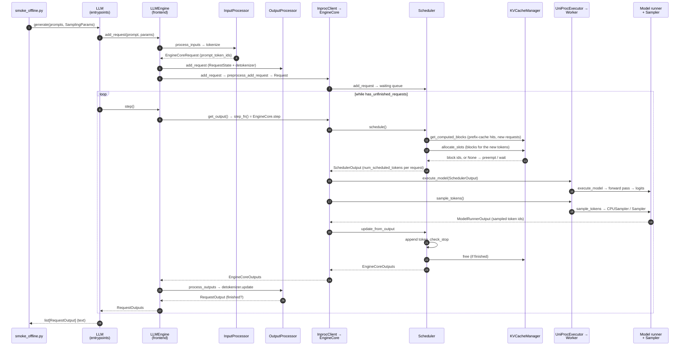
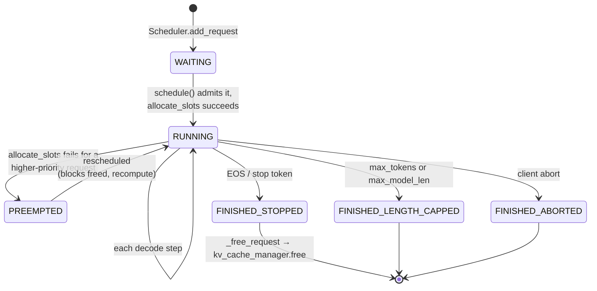
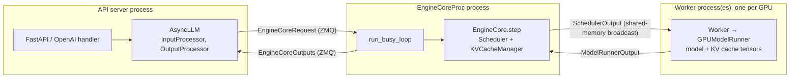

# vLLM v1 Request Lifecycle

The path of one request through vLLM v1, from `LLM.generate` to the returned text, with the functions to break on. Traced on the Mac CPU build at vLLM `cef9a453b2` (2026-11-08) using `smoke_offline.py` with `VLLM_ENABLE_V1_MULTIPROCESSING=0`. The breakpoint list and VS Code setup are in [README.md](README.md) ("Debugging the request lifecycle in VS Code").

Line numbers are for `cef9a453b2` and drift with every upstream commit. In VS Code, jump by symbol (`Cmd+T`) rather than by line.

## Table of Contents
- [[#The Big Picture]]
- [[#Sequence Diagram]]
- [[#Request States]]
- [[#Stage by Stage]]
- [[#Prefill vs Decode Steps]]
- [[#Offline vs Online Serving]]
- [[#Breakpoint Exercise]]
- [[#Questions to Answer While Stepping]]

## The Big Picture
vLLM v1 splits a request's life across three layers:

| Layer | Runs where | Owns | Key classes |
|---|---|---|---|
| **Frontend** | The user's process | Tokenization, detokenization, the per-request output queue | `LLM` / `LLMEngine` (offline), `AsyncLLM` (API server), `InputProcessor`, `OutputProcessor` |
| **EngineCore** | Same process (`InprocClient`, our debug setup) or a separate process (`EngineCoreProc` over ZMQ, the default) | The step loop, the scheduler, the KV block pool | `EngineCore`, `Scheduler`, `KVCacheManager` |
| **Workers** | In-process (`UniProcExecutor`) or one process per GPU (`MultiprocExecutor`) | The model weights, the KV cache tensors, the forward pass and sampling | `Worker` / `CPUWorker`, `GPUModelRunner` / `StandaloneCPUModelRunner`, `Sampler` / `CPUSampler` |

The core loop is three calls in `EngineCore.step`: **schedule → execute → update**. Every iteration decides which requests run and how many tokens each gets, runs one forward pass over that batch, then folds the sampled tokens back into each request.

## Sequence Diagram
One request, offline API, in-process engine (our debug setup). Numbers match the breakpoint table in the README.

## Request States
`RequestStatus` in `vllm/v1/request.py:425`. Only the common path is shown; the `WAITING_FOR_*` states cover structured-output grammars, remote KV transfer and streaming input.

## Stage by Stage
| # | Stage | Where (`cef9a453b2`) | What happens |
|---|---|---|---|
| 1 | Entry | `vllm/entrypoints/llm.py:424` `LLM.generate` → `vllm/entrypoints/common/offline.py:340` `_run_completion` | Normalizes prompts and `SamplingParams`, adds every request, then runs the engine loop |
| 2 | Tokenize | `vllm/v1/engine/llm_engine.py:229` `LLMEngine.add_request` → `input_processor.process_inputs` (line 271) | Prompt → `prompt_token_ids`, wrapped in an `EngineCoreRequest`. Registers a `RequestState` with the `OutputProcessor` (line 297), which holds the incremental detokenizer |
| 3 | Enqueue | `vllm/v1/engine/core_client.py:434` `InprocClient.add_request` → `vllm/v1/engine/core.py:1258` `preprocess_add_request` → `core.py:564` `EngineCore.add_request` → `vllm/v1/core/sched/scheduler.py:3065` `Scheduler.add_request` | `EngineCoreRequest` → `Request` (computes block hashes for prefix caching). Status `WAITING`, appended to `scheduler.waiting` |
| 4 | Engine loop | `offline.py:589` `_run_engine`: `while has_unfinished_requests(): llm_engine.step()` → `llm_engine.py:319` `step` → `core_client.py:424` `get_output` → `core.py:713` `EngineCore.step` | One iteration per call. `step_fn` is `step`, or `step_with_batch_queue` when pipelining is on |
| 5 | Schedule | `scheduler.py:716` `Scheduler.schedule` | Starts from `token_budget = max_num_scheduled_tokens`. First loops over `self.running` (decodes and unfinished chunked prefills), then admits from `self.waiting` while budget and KV blocks last. Returns a `SchedulerOutput` (`scheduled_new_reqs`, cached reqs, `num_scheduled_tokens`) |
| 6 | KV blocks | `vllm/v1/core/kv_cache_manager.py:288` `get_computed_blocks` (prefix-cache hits, new requests only), `:401` `allocate_slots` | PagedAttention's bookkeeping: hands out fixed-size block ids from the free pool. `None` means no room, so the scheduler preempts the lowest-priority running request (`_preempt_request`, `scheduler.py:1138`) or leaves the new one waiting |
| 7 | Forward | `vllm/v1/executor/uniproc_executor.py:119` `execute_model` → `collective_rpc` → `Worker.execute_model` (`vllm/v1/worker/gpu_worker.py:1442`; `CPUWorker` inherits it) → `vllm/v1/worker/cpu/standalone_model_runner.py:996` `execute_model` | Applies the `SchedulerOutput` to the persistent input batch, builds flattened `input_ids` / positions / block tables, runs the model, keeps the logits |
| 8 | Sample | `model_executor.sample_tokens` inside `EngineCore.step` → `uniproc_executor.py:134` → `standalone_model_runner.py:1173` `sample_tokens` → `vllm/v1/worker/cpu/sampler.py:543` `CPUSampler.__call__` | Logits → next token id per request (greedy with `temperature=0`). Returns a `ModelRunnerOutput` |
| 9 | Update | `scheduler.py:2301` `update_from_output` → `:2879` `_update_request_with_output` → `vllm/v1/core/sched/utils.py:98` `check_stop` | Appends the token, advances `num_computed_tokens`, caches full blocks for prefix reuse, checks EOS / `max_tokens` / `max_model_len`. Finished requests go through `_free_request` → `_free_blocks` → `kv_cache_manager.free` (`scheduler.py:3229`). Emits one `EngineCoreOutput` per request |
| 10 | Detokenize | `vllm/v1/engine/output_processor.py:731` `process_outputs` → `detokenizer.update` (line 828) | New token ids → incremental text, stop strings, logprobs. Builds a `RequestOutput`; `finished=True` once the engine reported a finish reason |
| 11 | Return | `offline.py` `_run_engine` | Collects finished outputs, sorts them back into prompt order, returns them from `LLM.generate` |

On GPU (Kaggle), rows 7–8 are `GPUModelRunner.execute_model` / `sample_tokens` in `vllm/v1/worker/gpu_model_runner.py` and `Sampler.forward` in `vllm/v1/sample/sampler.py`. Everything else is the same code.

## Prefill vs Decode Steps
vLLM v1 has no separate "prefill phase" or "decode phase". Each step schedules a number of tokens per request, and the same forward pass handles both:

| | First step for a request (prefill) | Later steps (decode) |
|---|---|---|
| `num_scheduled_tokens[req]` | Prompt length minus prefix-cache hits, capped by the token budget (longer prompts are chunked over several steps) | 1 (more with speculative decoding) |
| `allocate_slots` | Blocks for the whole scheduled chunk | Usually nothing new; one block each time the sequence crosses a `block_size` boundary |
| Output | The first generated token (TTFT ends here) | One more token (one ITL interval) |

A single batch can mix both kinds of request. This is the mixing that explains our Week 1 benchmark gap: vLLM puts prefill chunks into decode steps by default, while SGLang runs prefill first ([LOG.md](../LOG.md), Triton experiment).

## Offline vs Online Serving
Our debug run uses the offline `LLM` class with the engine in-process. `vllm serve` uses the same EngineCore, wired differently:

- **Why separate processes.** Tokenization, detokenization and HTTP handling stay off the step loop's critical path, so the GPU isn't idle while Python does frontend work.
- **Why we turn it off for debugging.** With `VLLM_ENABLE_V1_MULTIPROCESSING=0`, `LLMEngine` uses `InprocClient`, and `get_output()` calls `EngineCore.step` directly. Breakpoints in the scheduler then hit in the debugged process.

## Breakpoint Exercise
Run **vLLM smoke (CPU, in-process)** in VS Code with breakpoints on rows 2, 5, 6, 9 and 10 at least. `smoke_offline.py` sends 2 prompts with `temperature=0.0, max_tokens=48`. Fill in what you see. This turns the diagram from "read" into "observed".

| Observation | Where to read it | Value |
|---|---|---|
| Prompt token counts | Row 2: `len(request.prompt_token_ids)` | |
| `max_num_scheduled_tokens` (token budget) | Row 5: `self.max_num_scheduled_tokens` | |
| `block_size` | Row 5: `self.block_size` on the `Scheduler` (or `self.cache_config.block_size`) | |
| Free blocks before the first prefill | Row 6: `self.block_pool.get_num_free_blocks()` on the `KVCacheManager` | |
| Step 1: `num_scheduled_tokens` per request | Row 5, the returned `SchedulerOutput` | |
| Step 1: block ids per request | Row 6, the return value of `allocate_slots` | |
| Step 2: `num_scheduled_tokens` per request | Row 5 | |
| First step where `allocate_slots` returns a new block | Row 6 (condition the breakpoint on a non-empty result) | |
| Finish reason and step number | Row 9: `request.status` after `check_stop` | |
| Free blocks after both finish | Row 9, after `kv_cache_manager.free` | |

Tips:
- Skip the startup noise (model load, KV profiling, warm-up call the runner before any real request). Add the condition `len(self.waiting) > 0 or len(self.running) > 0` on row 5.
- **Call Stack** shows rows 4 → 5 → 6 nested inside one `EngineCore.step`.
- To see PagedAttention's indirection in the runner, inspect the block table the runner builds from the `SchedulerOutput`: logical token positions map to block ids that need not be contiguous.

## Questions to Answer While Stepping
1. Where exactly does a prompt stop being a string and become token ids, and where do token ids become text again? (Rows 2 and 10: both in the frontend, never in EngineCore.)
2. Why does EngineCore never see text? What does that buy the multiprocess design?
3. In `schedule()`, why are running requests served before waiting ones?
4. What happens in `allocate_slots` when the free pool runs out, and who decides which request gets preempted?
5. A request is preempted and later rescheduled. Is its KV cache kept or recomputed in v1? (Check `_preempt_request` and what it does with the blocks.)
6. Where does prefix caching cut work: in the scheduler (fewer scheduled tokens) or in the runner?
7. Which parts of this path would a Week 2 scheduler PR touch, and which tests in `tests/v1/core` cover them ([vllm_core_tests.md](vllm_core_tests.md))?
